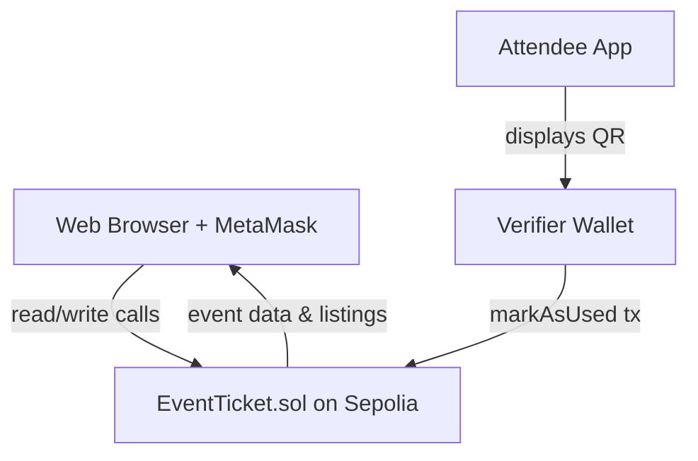

# TRUSTIX 🎟️

**A decentralized, NFT-based event ticketing platform that kills scalping, fake tickets, and unfair markups — for good.**

Tickets are minted as ERC-721 NFTs directly to a buyer's wallet, with resale price caps and creator royalties enforced by the smart contract itself, not by policy.


---

## Table of Contents

- [Overview](#overview)
- [Key Features](#key-features)
- [Tech Stack](#tech-stack)
- [Architecture](#architecture)
- [Deployed Contract](#deployed-contract)
- [Getting Started](#getting-started)
- [Usage Guide](#usage-guide)
- [Project Structure](#project-structure)
- [Known Limitations](#known-limitations)
- [Roadmap](#roadmap)
- [Screenshots](#screenshots)
- [License](#license)

---

## Overview

TRUSTIX reimagines event ticketing as an on-chain system instead of a centralized database controlled by a single vendor. Every ticket is a standard **ERC-721 token**, which means ownership, transfer history, and authenticity are all cryptographically verifiable — no more fake PDFs, no more "sold out" scalper markups, and no more disputes over who actually owns a ticket.

The project was built end-to-end — smart contracts, testing, deployment, and a full React frontend — as a hands-on exploration of applied Web3 development.

## Key Features

| Feature | Description |
|---|---|
| 🎫 **Event Creation** | Organizers create on-chain events with custom dates and multi-tier ticket configurations (e.g. VIP vs General). |
| 🪙 **NFT Ticket Minting** | Buyers mint tickets directly from the contract as ERC-721 tokens straight to their wallet. |
| 🔁 **Secondary Resale Marketplace** | A built-in peer-to-peer marketplace for listing and buying resold tickets. |
| 🧢 **Resale Price Cap (110%)** | Resale price is capped on-chain (default 110% of original price) — scalping is structurally prevented, not just discouraged. |
| 💰 **Automatic Creator Royalty (5%)** | Every resale automatically routes a royalty back to the event organizer before the seller is paid out. |
| 🛡️ **Verifier Role Management** | Contract owners can grant gate-staff wallets a dedicated verifier role, separate from admin/organizer permissions. |
| 📷 **QR-Based Entry Verification** | Live camera-based QR scanning at the gate checks the ticket's contract, existence, and on-chain used/valid status. |

## Tech Stack

- **Frontend:** React + Vite, custom dark-themed vanilla CSS
- **Smart Contracts:** Solidity, Hardhat (Mocha/Chai test suite)
- **Web3 Integration:** Ethers.js v6
- **QR Handling:** `@yudiel/react-qr-scanner` (scanning), `qrcode.react` (generation)
- **Network:** Sepolia Ethereum Testnet
- **Wallet:** MetaMask

## Architecture

TRUSTIX connects a React client directly to a deployed Solidity contract (`EventTicket.sol`) through MetaMask — there is no backend server or off-chain database in the loop.



**Contract layer** handles event creation, ticket supply and per-wallet mint limits (max 4), secondary listing/transfer logic, gate check-in status, and verifier role authorization.

**Frontend layer** connects via Ethers.js, reconstructs each user's ticket history by scanning token ownership, generates per-ticket QR codes, and drives the camera-based scanner used for gate admittance.

## Deployed Contract

The frontend reads the contract address from `VITE_CONTRACT_ADDRESS` (copy `frontend/.env.example` to `frontend/.env`). There is **no fallback address**: if it is missing or invalid the app shows a configuration error and will not connect.

> The original Sepolia deployment (`0x83fdB96C679E42924f9F63c1441e4dE291883803`) predates the contract fixes (transfer restriction, used-ticket and royalty validation). Deploy the current contract yourself and use that address.

The deploy script refuses to run unless the connected chain ID is Sepolia (11155111) and the deployer balance covers the estimated cost, and it makes these checks before sending any transaction.

After deploying, verify the source on Etherscan. The constructor takes the initial owner, so pass the deployer address (the deploy script prints the exact command):

```bash
npx hardhat verify --network sepolia <contract-address> <deployer-address>
```

## Getting Started

### Prerequisites

- [Node.js](https://nodejs.org/) installed
- [MetaMask](https://metamask.io/) browser extension
- Sepolia testnet ETH in your wallet ([faucet](https://sepoliafaucet.com/))

### 1. Clone & Install

```bash
git clone https://github.com/prakhargit-04/event-ticketing-dapp.git
cd event-ticketing-dapp

# Install root/Hardhat dependencies
npm install

# Install frontend dependencies
cd frontend
npm install
cd ..
```

### 2. Configure Environment Variables

Create a `.env` file in the project root:

```env
SEPOLIA_RPC_URL="your-alchemy-or-infura-sepolia-rpc-url"
PRIVATE_KEY="your-wallet-private-key-with-sepolia-eth"
ETHERSCAN_API_KEY="your-etherscan-api-key"   # only needed for `hardhat verify`
```

> ⚠️ `.env` is already listed in `.gitignore` — never commit your private key.

### 3. Compile & Test the Contracts (optional)

```bash
npx hardhat compile
npx hardhat test
```

### 4. Run the Frontend

```bash
cd frontend
npm run dev
```

Open **http://localhost:5173** in your browser.

## Usage Guide

1. **Connect Wallet** — Click **Connect Wallet** and confirm in MetaMask. The app checks the network and prompts you to switch to Sepolia if needed.
2. **Browse Events** — View live events, check tier availability, and click **Buy Ticket** to mint an NFT pass.
3. **Manage Passes** — Open **My Tickets** to see your minted passes, each with a dynamically generated QR code.
4. **List / Buy Resale**
   - From **My Tickets**, click **List for Resale** — the app enforces the 110% price cap client-side and on-chain.
   - Browse resold tickets from other users under **Secondary Resale Marketplace**.
5. **Gate Admittance**
   - Verifiers open the **Verify Passes** tab to activate the camera scanner.
   - Scanning a ticket verifies its contract origin, that it exists, and its on-chain used/valid status. It does **not** verify the presenter's identity: the QR holds only the contract address and token ID, so it cannot prove the person showing it controls the owning wallet.
   - **Mark as Used** records the check-in on-chain, preventing re-entry with the same ticket.

## Project Structure

```
event-ticketing-dapp/
├── contracts/          # EventTicket.sol — core Solidity contract
├── scripts/            # Deployment scripts
├── test/               # Hardhat/Mocha test suite
├── frontend/            # React + Vite client (EventPass UI)
│   ├── src/
│   └── ...
├── hardhat.config.js
└── package.json
```

## Known Limitations

- **Informational dates only** — event date/time are shown for scheduling purposes but are not enforced on-chain; expired events don't automatically block minting or gate admittance.
- **Direct transfers are disabled** — tickets can only be minted or moved through the in-app resale marketplace, so the price cap and royalty cannot be bypassed. The trade-off: you cannot gift/transfer a ticket for free outside the marketplace.
- **QR codes are not wallet-bound** — the QR contains only the contract address and token ID, so a screenshot of a ticket works for whoever presents it. The scanner does reject QR codes for a different contract or with malformed IDs. Wallet-signature challenges are a planned improvement.
- **Per-wallet mint limit** (4) can be sidestepped with multiple wallets.
- **Redeploy required for contract fixes** — the address listed above is the original deployment. After redeploying, set `VITE_CONTRACT_ADDRESS`.

## Verifying the Project

```bash
# contracts (project root)
npm ci && npx hardhat clean && npx hardhat compile && npx hardhat test

# frontend
cd frontend && npm ci && npm test && npm run build && npm run lint
```

Frontend `npm run build` and the app itself require `VITE_CONTRACT_ADDRESS` (see `frontend/.env.example`).

## Deploying the Frontend to Vercel

1. Push the repo to GitHub and import it in Vercel.
2. Set **Root Directory** to `frontend` (framework preset: Vite, build `npm run build`, output `dist`).
3. Add environment variable `VITE_CONTRACT_ADDRESS` (see `frontend/.env.example`). **Production builds refuse to connect if it is missing.** Never add `PRIVATE_KEY` to Vercel: it is only for local Hardhat deployment.
4. Use a recent Node version (22.x) in Project Settings.
5. Mobile browsers have no injected wallet: open the site inside the MetaMask in-app browser. HTTPS on Vercel enables camera QR scanning.

## Roadmap

- [ ] On-chain enforcement of event expiry
- [ ] Multi-organizer / multi-admin support
- [ ] Gas optimization pass on batch ticket queries
- [ ] Mainnet deployment

## Screenshots

> _Add screenshots to a `/screenshots` folder and update the paths below._

| Browse Events & Resale | My Tickets & QR | Gate Verification |
|---|---|---|
|  |  |  |

## License

This project is licensed under the [MIT License](LICENSE).

---

<p align="center">Built by <a href="https://github.com/prakhargit-04">@prakhargit-04</a></p>
